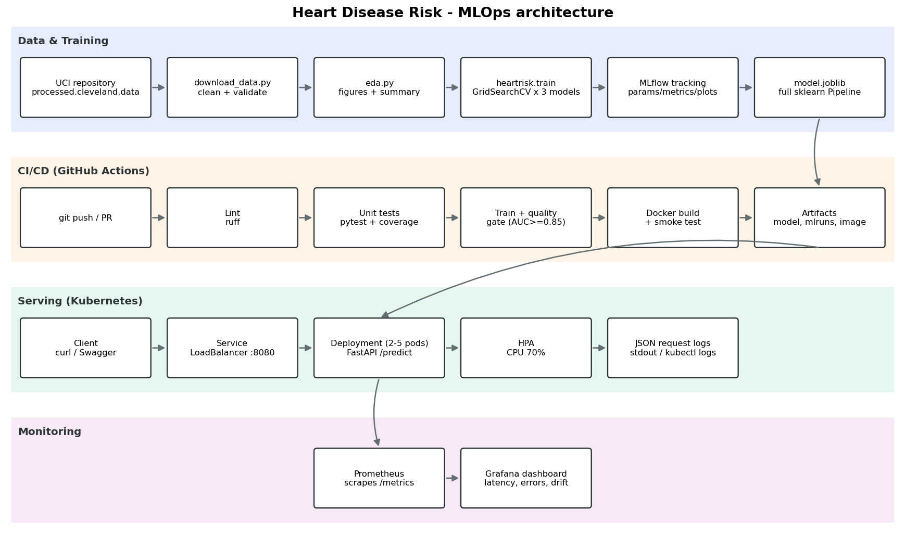

# Heart Disease Risk – End-to-End MLOps

Predicts the presence of heart disease from 13 clinical measurements (UCI Cleveland dataset) and serves the
model as a monitored, containerised FastAPI service on Kubernetes.



| Stage | Where |
|---|---|
| Data download + cleaning | [`scripts/download_data.py`](scripts/download_data.py), [`src/heartrisk/data.py`](src/heartrisk/data.py) |
| EDA | [`scripts/eda.py`](scripts/eda.py) → `reports/figures/eda_*.png`, [`reports/eda_summary.md`](reports/eda_summary.md) |
| Features + pipeline | [`src/heartrisk/features.py`](src/heartrisk/features.py) |
| Training + MLflow | [`src/heartrisk/train.py`](src/heartrisk/train.py) |
| Serving API | [`src/heartrisk/api.py`](src/heartrisk/api.py), [`Dockerfile`](Dockerfile) |
| Tests | [`tests/`](tests) |
| CI/CD | [`.github/workflows/ci.yml`](.github/workflows/ci.yml) |
| Kubernetes | [`k8s/`](k8s), [`scripts/deploy_k8s.sh`](scripts/deploy_k8s.sh) |
| Monitoring | [`docker-compose.yml`](docker-compose.yml), [`monitoring/`](monitoring) |
| Report | [`REPORT.md`](REPORT.md) / `report/REPORT.docx` |

## 1. Setup

```bash
python3.11 -m venv .venv && source .venv/bin/activate
pip install -r requirements.txt
pip install -e .
```

## 2. Data, EDA, training

```bash
python scripts/download_data.py        # -> data/raw/, data/processed/heart_clean.csv
python scripts/eda.py                  # -> reports/figures/eda_*.png
python -m heartrisk.train              # 3 models x grid search x 5-fold CV, logged to ./mlruns
mlflow ui --backend-store-uri ./mlruns # http://127.0.0.1:5000
```

The champion model (best mean CV ROC-AUC) is refit on all data and written to `models/model.joblib`
(full sklearn `Pipeline`: feature engineering → imputation → scaling/one-hot → classifier) together with
`models/metadata.json`. It is also logged as an MLflow model with signature and bundled source code.

## 3. Tests and lint

```bash
ruff check . && ruff format --check .
pytest --cov=heartrisk
```

## 4. Run the API in Docker

```bash
docker build -t heart-risk-api:1.0.0 .
docker run --rm -p 8000:8000 heart-risk-api:1.0.0
curl -X POST localhost:8000/predict -H 'Content-Type: application/json' -d @samples/patient_high_risk.json
# {"prediction":1,"label":"heart_disease","confidence":0.9969,"probability_disease":0.9969,...}
```

Swagger UI: http://localhost:8000/docs · Health: `/health` · Prometheus metrics: `/metrics`

## 5. Monitoring (Prometheus + Grafana)

```bash
docker compose up -d --build
python scripts/load_test.py --n 400          # generate traffic (5% invalid payloads)
```

* Grafana: http://localhost:3000 (admin/admin) – dashboard **Heart Risk API – Service & Model Monitoring**
* Prometheus: http://localhost:9090
* Logs: `docker compose logs -f api` (one JSON object per request)

## 6. Deploy to Kubernetes (Docker Desktop)

Enable Kubernetes in Docker Desktop → Settings → Kubernetes, then:

```bash
./scripts/deploy_k8s.sh
# or manually
kubectl apply -f k8s/
kubectl -n heart-risk get pods,svc,hpa
curl -X POST localhost:8080/predict -H 'Content-Type: application/json' -d @samples/patient_low_risk.json
```

The `LoadBalancer` service is published on **http://localhost:8080**. An optional Ingress
(`k8s/optional/ingress.yaml`) routes `heart-risk.local` through ingress-nginx.

## 7. CI/CD

Every push / PR runs: **lint → unit tests → data + EDA + training (with quality gate) → Docker build + smoke
test**. Any failing step stops the pipeline. Each job uploads artifacts (JUnit + coverage, model, MLflow runs,
figures, Docker image and container logs).
