# 1. Summary

This project builds a binary classifier that predicts whether a patient has heart disease from 13 routine
clinical measurements (UCI Heart Disease, Cleveland subset). It also delivers the whole production setup around
the model: scripted data acquisition, EDA, a reproducible sklearn pipeline, MLflow experiment tracking,
automated tests, a GitHub Actions CI/CD pipeline, a Docker image serving a FastAPI `/predict` endpoint,
Kubernetes manifests (Deployment, LoadBalancer Service, HPA, optional Ingress), and monitoring with
Prometheus and Grafana.

| Item | Value |
|---|---|
| Code repository | `https://github.com/sushil32/heart-risk-mlops` |
| Champion model | Logistic Regression (C = 1.0, class_weight = balanced) |
| Cross-validated ROC-AUC (5-fold, train split) | **0.908** |
| Hold-out test ROC-AUC / accuracy / recall | **0.960 / 0.902 / 0.929** |
| API access (local K8s) | `http://localhost:8080` (Docker Desktop LoadBalancer) |
| API access (Docker) | `http://localhost:8000`, Swagger at `/docs` |

# 2. Setup and installation

Prerequisites: Python 3.11, Docker Desktop (with Kubernetes enabled for section 9), git.

```bash
git clone https://github.com/sushil32/heart-risk-mlops.git && cd heart-risk-mlops
python3.11 -m venv .venv && source .venv/bin/activate
pip install -r requirements.txt && pip install -e .

python scripts/download_data.py     # fetch + clean the dataset
python scripts/eda.py               # EDA figures -> reports/figures
python -m heartrisk.train           # train, tune, track (MLflow) and export the champion model
pytest --cov=heartrisk              # 24 unit tests
docker compose up -d --build        # API + Prometheus + Grafana
./scripts/deploy_k8s.sh             # deploy to Docker Desktop Kubernetes
```

There are two dependency files. `requirements.txt` has everything needed for training, tracking, tests and
lint. `requirements-serve.txt` has only what the API needs at runtime, which keeps the Docker image small and
reduces its attack surface. All versions are pinned, so a fresh environment always resolves the same way.

**Repository layout**

```
src/heartrisk/        data.py, features.py, train.py, api.py   (installable package)
scripts/              download_data.py, eda.py, load_test.py, make_architecture.py, deploy_k8s.sh
tests/                test_data.py, test_model.py, test_api.py, conftest.py
data/raw, data/processed     raw UCI file and cleaned CSV
models/               model.joblib + metadata.json (champion)
k8s/                  namespace, deployment+configmap, service+HPA, optional ingress
monitoring/           prometheus.yml, Grafana provisioning + dashboard JSON
.github/workflows/    ci.yml
reports/, screenshots/   figures, EDA summary, model comparison, screenshots
```

# 3. Architecture


There are four layers. (1) **Data and training**: data is downloaded and validated, EDA figures are produced,
three model families are tuned, and every run is tracked in MLflow; the best pipeline is exported as a
single artefact. (2) **CI/CD**: every push runs lint, tests, training with a quality gate, and an image build
with a smoke test. (3) **Serving**: the image runs as a Kubernetes Deployment with two to five replicas behind
a LoadBalancer. (4) **Monitoring**: Prometheus scrapes `/metrics`, Grafana shows service and model health, and
every request is logged as structured JSON.

# 4. Data acquisition and cleaning

`scripts/download_data.py` downloads `processed.cleveland.data` from the UCI repository, records its SHA-256
fingerprint, and writes `data/processed/heart_clean.csv`. The cleaning logic is in `heartrisk.data.clean()`
and is covered by unit tests. It does the following:

* parses `?` as missing and converts every column to numeric;
* **validates domain ranges** (e.g. cholesterol 100–650 mg/dl, max heart rate 60–230) and allowed category
  codes (e.g. `thal ∈ {3, 6, 7}`), setting anything invalid to missing instead of letting it pass silently;
* binarises the target: `num > 0` becomes 1 (disease), `num = 0` becomes 0;
* removes exact duplicates.

The raw file has 303 rows. Only 6 cells are missing: `ca` = 4 and `thal` = 2. These are **kept as NaN in the
cleaned CSV on purpose and imputed inside the model pipeline**, so the imputation statistics are learned only
from the training folds. Imputing before the split would leak information from validation and test data into
training.

# 5. Exploratory data analysis

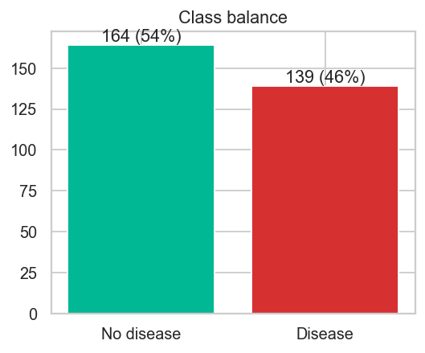{width=45%} 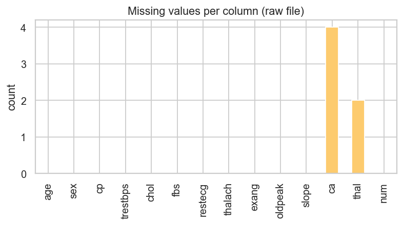{width=52%}

The classes are close to balanced: 164 patients without disease (54%) and 139 with disease (46%). Accuracy is
therefore a meaningful metric. ROC-AUC and recall are still tracked because, in a screening setting, missing a
sick patient costs more than a false alarm.

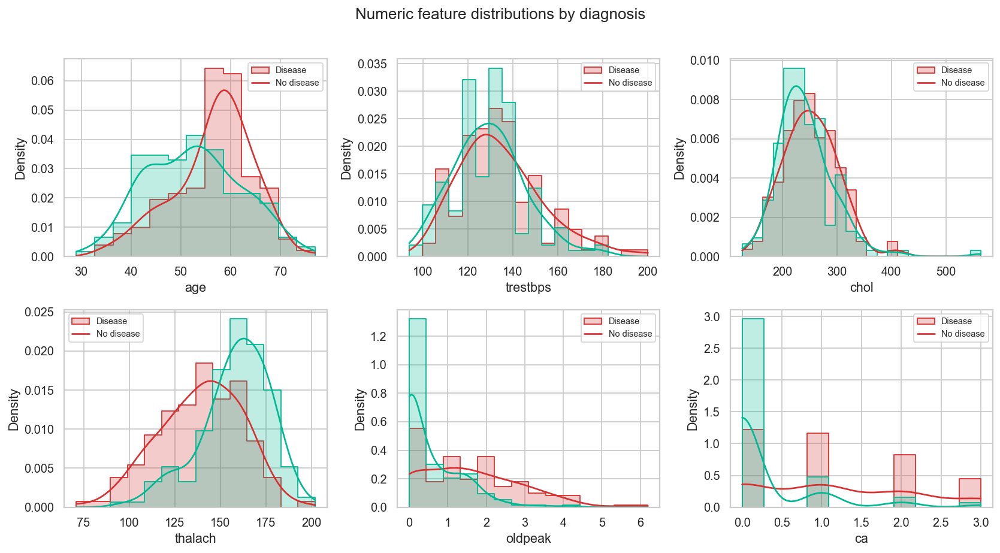

Patients with disease reach a clearly **lower maximum heart rate** (`thalach`), have **higher ST depression**
(`oldpeak`), and have **more major vessels coloured** (`ca`). Age is shifted only slightly. Cholesterol and
resting blood pressure barely separate the two classes.

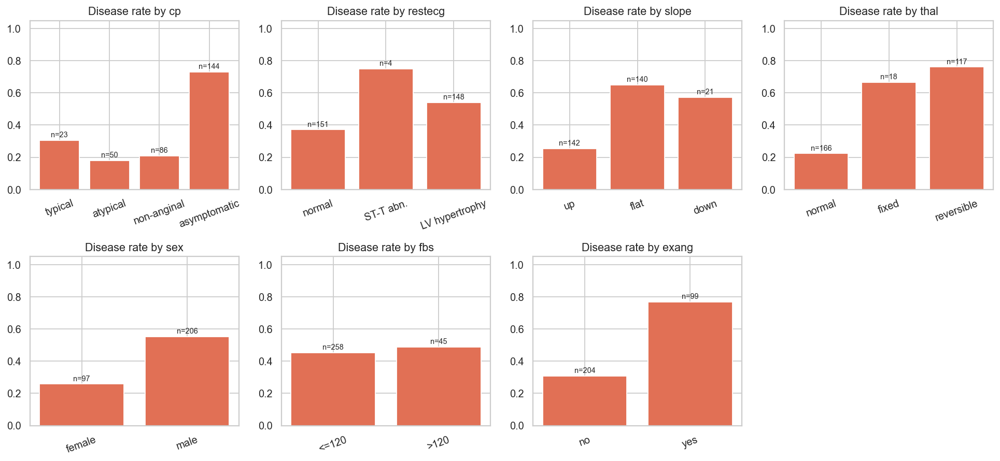

Disease rate by category shows strong categorical signals. **Asymptomatic chest pain** (`cp = 4`, 73%), a
**reversible thalium defect** (`thal = 7`, 76%) and **exercise-induced angina** (77%) go with the highest
disease rates. A **flat ST slope** (65%) and **male sex** (55% vs 26% for women) also raise risk. Fasting
blood sugar is almost uninformative (45% vs 49%).

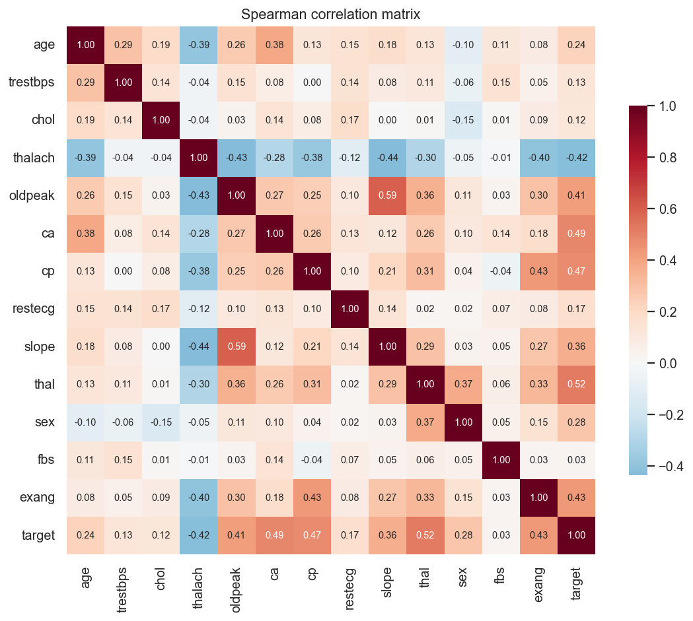{width=80%}

The strongest Spearman correlations with the target are `thal` (0.52), `ca` (0.49), `cp` (0.47), `exang`
(0.43), `thalach` (−0.42) and `oldpeak` (0.41). No pair of features is so highly correlated that one must be
dropped, so all 13 features are kept. Boxplots (`eda_boxplots.png`) show a few high cholesterol values
(up to 564 mg/dl). They are clinically possible, so they are kept, and scaling plus tree models handle them.

**Engineered feature.** Because `thalach` is strongly predictive but naturally falls with age, I added a
**heart-rate reserve ratio**, `thalach / (220 − age)`: the share of the age-predicted maximum heart rate the
patient reached. Values well below 1 indicate chronotropic incompetence. Its distribution (below) is clearly
shifted lower for patients with disease. A coarse `age_band` feature was also added so the linear model
can capture non-linear age risk.

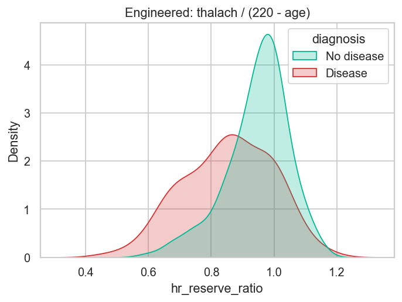{width=60%}

# 6. Feature engineering and model development

**Pipeline.** All preprocessing lives in a single sklearn `Pipeline`, so training and serving use exactly the
same code path:

1. `ClinicalFeatures` (custom transformer): adds `hr_reserve_ratio` and `age_band`.
2. `ColumnTransformer`:
   * numeric (`age, trestbps, chol, thalach, oldpeak, ca, hr_reserve_ratio`): median imputation, then
     `StandardScaler`;
   * categorical (`cp, restecg, slope, thal, age_band`): most-frequent imputation, then `OneHotEncoder`
     (`handle_unknown="ignore"`, so an unseen code at inference time does not crash the API);
   * binary (`sex, fbs, exang`): most-frequent imputation.
3. Classifier.

**Models and tuning.** The data is split 80/20 with stratification (seed 42). Three model families are tuned
with `GridSearchCV` using 5-fold stratified CV on the training split, with `roc_auc` as the refit metric:

| Model | Grid | Grid size |
|---|---|---|
| Logistic Regression | C ∈ {0.01, 0.1, 1, 10}, class_weight ∈ {None, balanced} | 8 |
| Random Forest | n_estimators ∈ {200, 400}, max_depth ∈ {None, 4, 8}, min_samples_leaf ∈ {1, 4} | 12 |
| Gradient Boosting | n_estimators ∈ {100, 200}, learning_rate ∈ {0.05, 0.1}, max_depth ∈ {2, 3} | 8 |

**Results** (CV = mean of 5 folds on the training split; test = 61-patient hold-out):

| Model | CV acc | CV prec | CV recall | CV ROC-AUC | Test acc | Test recall | Test ROC-AUC |
|---|---|---|---|---|---|---|---|
| **Logistic Regression** | **0.843** | **0.850** | **0.802** | **0.908** | 0.902 | 0.929 | 0.960 |
| Random Forest | 0.814 | 0.828 | 0.755 | 0.901 | 0.869 | 0.893 | 0.952 |
| Gradient Boosting | 0.826 | 0.836 | 0.783 | 0.878 | 0.902 | 0.929 | 0.968 |

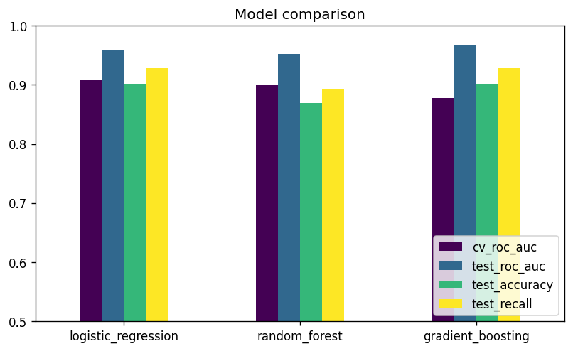{width=75%}

**Selection.** The champion is chosen by **mean CV ROC-AUC, not test score**. With only 61 test patients a
single misclassification moves accuracy by 1.6 points, so the test set is used only for the final report.
Gradient Boosting has the best test AUC but the lowest CV AUC, which points to variance rather than a real
advantage. Logistic Regression wins on every CV metric, and it is also the most interpretable and the fastest
to serve. Its largest absolute coefficients agree with the EDA: male sex, `ca`, asymptomatic chest pain, and
a reversible thal defect. The champion is refit on all 303 rows before export.

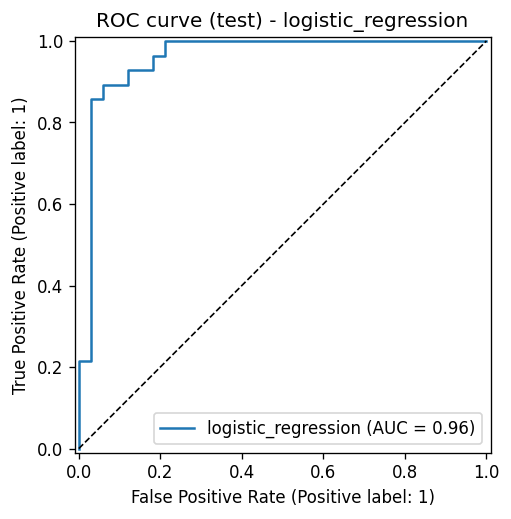{width=48%} 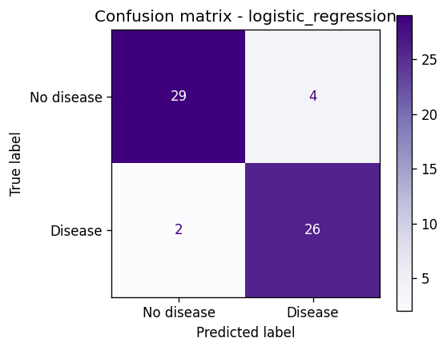{width=48%}

# 7. Experiment tracking (MLflow)

`heartrisk.train` logs to the MLflow experiment **heart-disease-risk**:

* **One parent run per model family** with: best hyper-parameters, grid size, CV folds, train/test sizes;
  CV mean and std for accuracy, precision, recall, F1 and ROC-AUC; test metrics; plots (ROC curve, confusion
  matrix, feature importance); the full `cv_results_` CSV; and the fitted pipeline as an MLflow model with
  input signature, input example and bundled source code (`code_paths`), so it loads without the repo.
* **One nested child run per grid candidate**: 28 runs, each with its parameters and CV metrics, so every
  configuration tried can be inspected and compared in the UI.
* **A `champion-*` run** tagged `stage=champion` that holds the final refit model, `metadata.json` and the
  comparison chart.

That gives 32 tracked runs per training execution. The UI is started with
`mlflow ui --backend-store-uri ./mlruns`. In CI the `mlruns/` folder is uploaded as a build artifact.

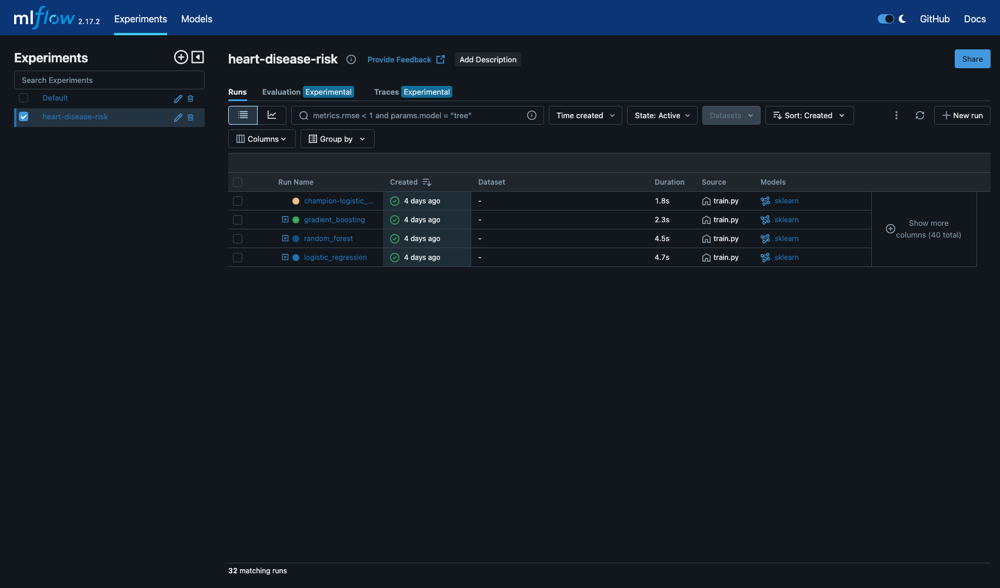

# 8. Packaging, reproducibility and testing

* **Model format:** `models/model.joblib` holds the full sklearn pipeline (feature engineering, preprocessing
  and classifier), so raw patient JSON goes straight in. `models/metadata.json` stores the model name,
  version, training timestamp, feature list, best parameters, metrics and the MLflow run id; the API reports
  it. The same model is also stored in MLflow format.
* **Reproducibility:** pinned dependencies, fixed random seeds (split, CV folds and models), the package is
  installed with `pip install -e .`, and data is fetched by a script with a checksum log.
* **Unit tests (24, pytest):**
  * `test_data.py`: `?` parsing, target binarisation, duplicate removal, invalid values become missing,
    schema, no mutation of the input.
  * `test_model.py`: engineered feature values, imputation and scaling output, unseen categories, the
    pipeline learns signal (AUC > 0.7 on synthetic data), metric function, feature-importance alignment,
    grid naming, and a joblib save/load round-trip with identical predictions.
  * `test_api.py`: `/health`, `/predict` schema and confidence range, optional fields, 422 on invalid or
    missing inputs, `/metrics` contents, and structured JSON request logs.

  The tests use a synthetic fixture dataset, so they need no network access and run in about 2 seconds.

# 9. CI/CD pipeline (GitHub Actions)

`.github/workflows/ci.yml` runs on every push to `main`, on pull requests, and on manual dispatch. Each job
depends on the previous one, so a failure stops the pipeline with a clear log:

| Job | Steps | Artifacts |
|---|---|---|
| **lint** | `ruff check` (with GitHub annotations), `ruff format --check` | – |
| **test** | install, `pytest -v --cov`, JUnit XML | `test-results/` (JUnit + coverage) |
| **train** | download data, EDA, train, **quality gate** (fails if champion CV ROC-AUC < 0.85), model table in job summary | `model/`, `training-artifacts/` (mlruns, figures, log, clean CSV) |
| **docker** | build image with the freshly trained model, run it, wait for `/health`, POST both samples and check the response, confirm invalid input returns 422, check `/metrics` | `docker-image-and-logs/` (image tarball, container log) |

I checked locally that the lint gate fails the build: an over-long line in an early version was rejected
before any test ran.

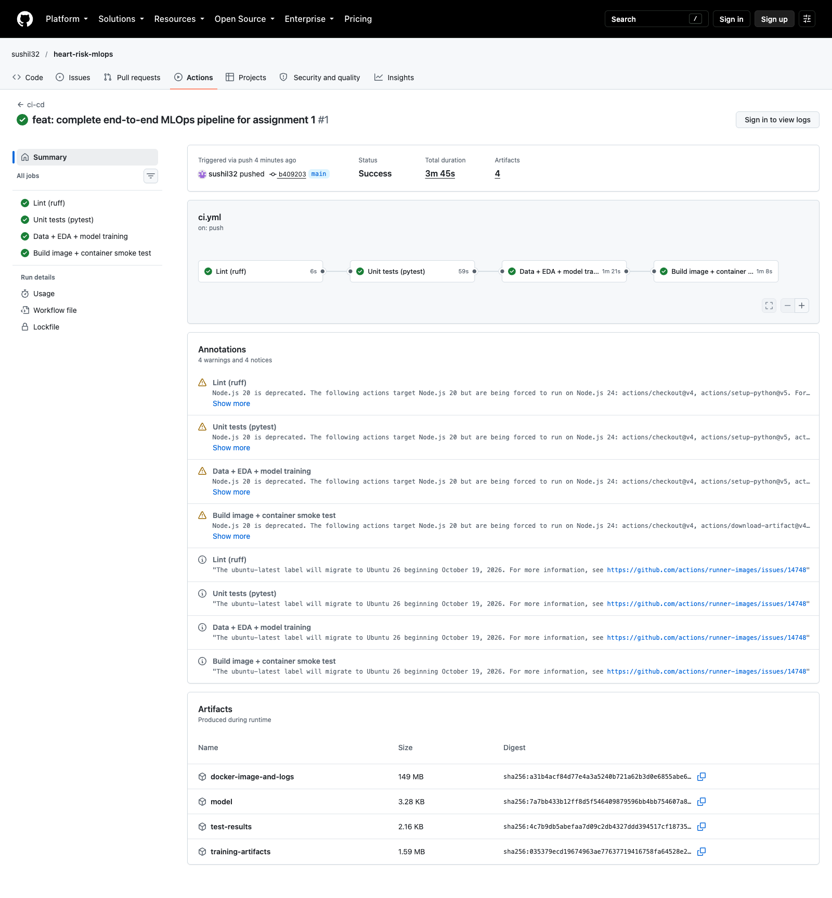

# 10. Containerisation and deployment

**Docker image.** Based on `python:3.11-slim`, it installs only the serving dependencies plus the
`heartrisk` package and copies in the model. It runs as a non-root user (uid 10001), has a `HEALTHCHECK`,
and uses an allow-list `.dockerignore` so data, venvs and mlruns never enter the build context.

```bash
$ curl -X POST localhost:8000/predict -H 'Content-Type: application/json' -d @samples/patient_high_risk.json
{"prediction":1,"label":"heart_disease","confidence":0.9969,"probability_disease":0.9969,
 "model_name":"logistic_regression","model_version":"1.0.0"}
$ curl -X POST localhost:8000/predict -H 'Content-Type: application/json' -d @samples/patient_low_risk.json
{"prediction":0,"label":"no_heart_disease","confidence":0.7577,"probability_disease":0.2423, ...}
```

The request is validated with Pydantic, using clinical ranges and allowed codes; invalid input gets an HTTP
422 with a field-level message. `ca` and `thal` are optional because they are the fields most often missing
in practice, and the pipeline imputes them.

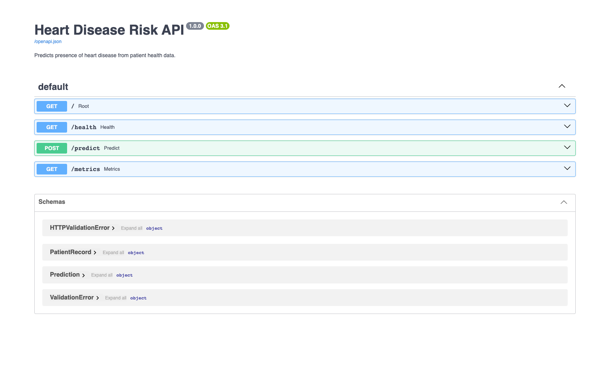

**Kubernetes (Docker Desktop).** The manifests in `k8s/`:

* `00-namespace.yaml`: namespace `heart-risk`.
* `10-deployment.yaml`: ConfigMap plus a Deployment with 2 replicas, a zero-downtime rolling update
  (`maxUnavailable: 0`), readiness and liveness probes on `/health`, CPU and memory requests/limits,
  `runAsNonRoot`, a read-only root filesystem, and Prometheus scrape annotations.
* `20-service.yaml`: a `LoadBalancer` Service on port 8080 (Docker Desktop publishes it on `localhost`) and
  an HPA that scales from 2 to 5 pods at 70% CPU.
* `optional/ingress.yaml`: an ingress-nginx route for `heart-risk.local`.

`scripts/deploy_k8s.sh` builds the image, applies the manifests, waits for the rollout and calls the
endpoints.

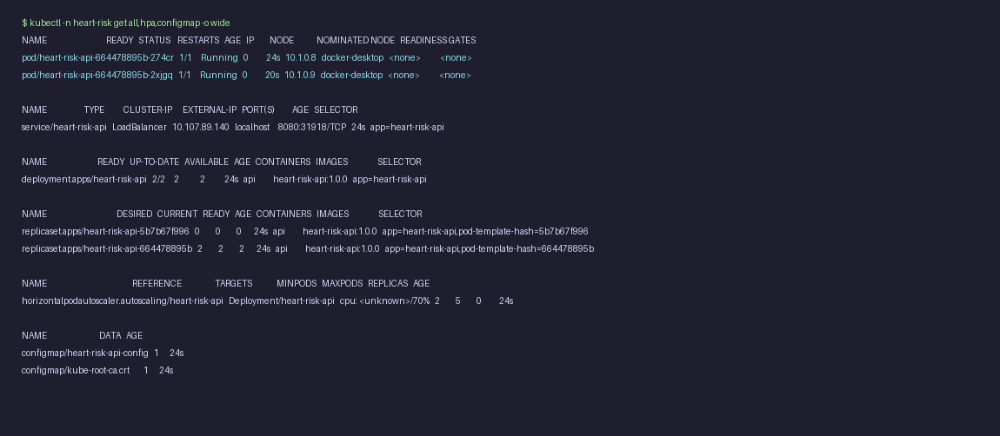

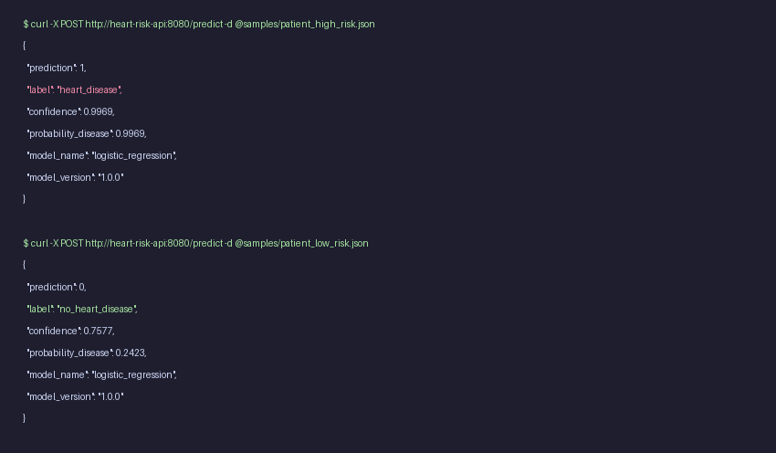

# 11. Monitoring and logging

**Logging.** An HTTP middleware writes one JSON line per request: timestamp, request id (also returned in the
`x-request-id` header), method, path, status, latency in ms, and client. Each prediction also logs its label
and confidence. JSON logs can be read with `kubectl logs` or `docker compose logs` and can be shipped to
Loki or ELK without parsing rules.

**Metrics** (`/metrics`, Prometheus format):
`heartrisk_http_requests_total{method,path,status}`, `heartrisk_http_request_duration_seconds` (histogram),
`heartrisk_predictions_total{label}`, `heartrisk_prediction_confidence` (histogram) and
`heartrisk_model_loaded{model_name,version}`.

**Dashboard.** `docker compose up` starts the API, Prometheus (5-second scrape interval) and Grafana with the
datasource and dashboard already provisioned. Panels: requests/s, error rate, p95 latency, total
predictions, traffic by path and status, p50/p95/p99 latency, predicted class mix, **positive prediction
rate over time** (a simple prediction-drift signal: in production a sudden change away from the training
base rate of about 46% would trigger an investigation), and the confidence distribution (a rising share of
low-confidence predictions suggests input drift). `scripts/load_test.py` generates realistic traffic with a
configurable share of invalid payloads, which is how the screenshot below was produced.

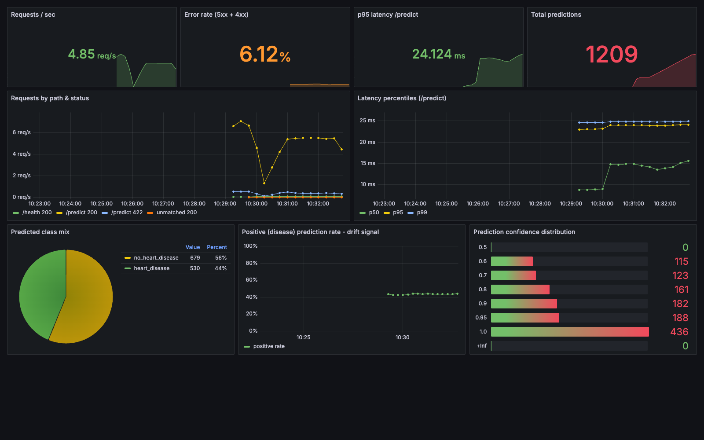

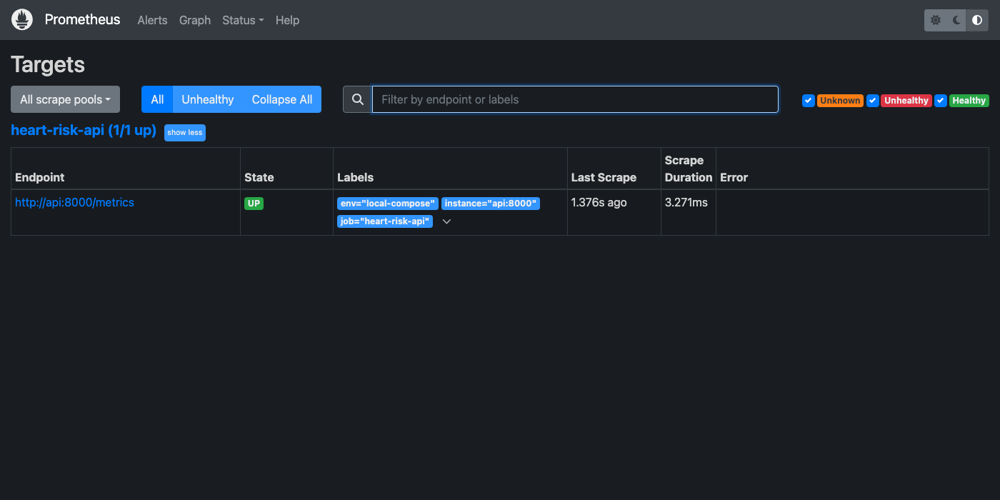{width=80%}

# 12. Design choices, limitations and next steps

* **Small dataset (303 rows).** CV estimates carry roughly ±0.04 AUC of fold-to-fold spread, which is why a
  simple, well-regularised model was chosen over a slightly higher test score.
* **Threshold.** The API uses 0.5. For screening, a lower threshold would raise recall; the threshold could
  be made configurable through the ConfigMap after review with clinicians.
* **Model registry.** A local file store is used. A shared MLflow server with a database backend would allow
  the Model Registry and stage promotion to be used from CI.
* **Continuous delivery.** The pipeline builds and tests the image. Pushing it to GHCR and running
  `kubectl apply` against a cloud cluster (GKE or EKS) would complete continuous deployment.
* **Drift.** The dashboard tracks prediction drift. Logging input feature distributions and comparing them
  with training statistics (e.g. a PSI metric) would add data-drift detection.

# 13. Deliverables checklist

| Deliverable | Location |
|---|---|
| Code, Dockerfile, requirements | `src/`, `Dockerfile`, `requirements*.txt`, `pyproject.toml` |
| Cleaned dataset + download script | `data/processed/heart_clean.csv`, `scripts/download_data.py` |
| EDA / training / inference scripts | `scripts/eda.py`, `src/heartrisk/train.py`, `src/heartrisk/api.py`, `scripts/load_test.py` |
| Unit tests | `tests/` |
| CI workflow | `.github/workflows/ci.yml` |
| Deployment manifests | `k8s/` |
| Monitoring | `docker-compose.yml`, `monitoring/` |
| Screenshots | `screenshots/` |
| Report | `REPORT.md`, `report/REPORT.docx` |
| Access instructions | `README.md` sections 4–6 |
